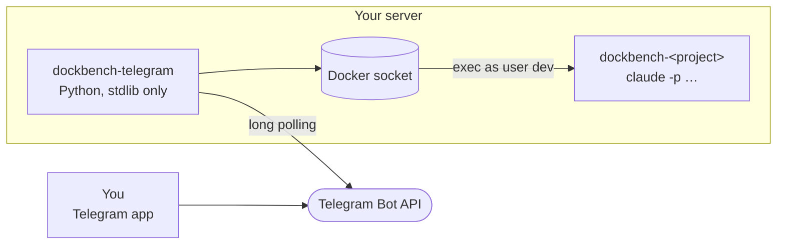

<div align="center">


# DockBench Telegram

**Claude Code in your dev containers, from a Telegram chat.**

One forum topic per DockBench container. Post a task, pick a model, get the answer as a reply, with screenshots in both directions. Several sessions at once, from your phone.

[](https://github.com/Sander972/DockBench-telegram/actions/workflows/build.yml)
[](https://github.com/Sander972/DockBench-telegram/pkgs/container/dockbench-telegram)
[](#build-it-yourself)
[](LICENSE)
<br>
[](https://github.com/Sander972/DockBench-telegram/commits/main)
[](https://github.com/Sander972/DockBench-telegram/issues)
[](#contributing)

[Getting started](#getting-started) · [Everyday use](#everyday-use) · [Commands](#commands) · [Configuration](#configuration) · [Security](#security)

</div>

---

## What is it for?

[DockBench](https://github.com/Sander972/DockBench) runs one dev container per project on a server you own, with [Claude Code](https://claude.com/claude-code) installed inside. Opening VS Code is fine at a desk; from a phone, in a queue or on the couch, you just want to tell Claude "fix the failing test and commit" and read the answer when it is done.

This bot is that chat. A private Telegram forum group holds one topic per container. Every message you post in a topic starts a Claude Code session inside that container, headless, and the answer comes back as a reply. The sessions are real Claude Code sessions: they also appear in the VS Code of that container, so you can open one there and keep going.

### What it does

| | |
|---|---|
| 💬 **A topic per container** | New dev containers get their topic automatically, named after the project. Post text or a screenshot and a session starts in that container. |
| 🎛️ **Pick, then go** | Inline buttons ask the model, the effort and the permission mode for each new session, or repeat your last pick in one tap. |
| 🔁 **Threads are sessions** | Reply to any message of a session to continue it. Send a new message to start another one; sessions run in parallel. |
| 📷 **Images both ways** | Screenshots you send are copied into the container for Claude. Screenshots, charts and diagrams Claude makes come back as photos. |
| 📌 **Pinned status** | Each topic keeps a pinned message with the repo, branch, uncommitted changes, commits to push and the sessions, running or idle. |
| ⬆️ **Push button** | When a branch has commits to push, the pin shows a button. One confirmation tap and the container pushes with its own credentials. |
| 📊 **Claude usage** | A pinned message in General shows the plan limits of every Claude account signed in across your containers. |
| 🧩 **Claude's commands** | Your skills and slash commands show up in Telegram's `/` menu, grouped by plugin. |
| 🧑‍💻 **VS Code aware** | Open any Telegram session in the container's VS Code with its full history, tool calls and diffs. |

## How it works



- **No inbound traffic.** The bot long-polls Telegram over outbound HTTPS. No webhook, no published port, no reverse proxy.
- **Docker exec, nothing else.** A session is `claude -p` executed in the dev container as its normal user, with the prompt passed as one argument. Screenshots go in through the container's archive API, images come back the same way.
- **One JSON file of state.** Topic bindings, the last pick per topic and which message belongs to which session live in one volume. Message text is never stored or logged.
- **No dependencies.** Python standard library only, in a `python:3.13-alpine` image.

## Getting started

**You need:**

- a server where your [DockBench](https://github.com/Sander972/DockBench) containers run, with Docker (the published image is `linux/arm64`; [build it](#build-it-yourself) for x86);
- a Telegram account, and a bot token from [@BotFather](https://t.me/BotFather).

> [!TIP]
> The [DockBench Dashboard](https://github.com/Sander972/DockBench-Dashboard) does steps 1 to 3 for you: its Telegram page deploys the stack from the token, then shows a *Claim ownership* link and an *Add to group* link that asks Telegram for the right admin permissions. The steps below are the manual path.

### 1. Create the bot

Talk to [@BotFather](https://t.me/BotFather), create a bot and keep its token. Privacy mode can stay on: as a group admin the bot receives every message anyway.

### 2. Deploy it

Find the group id of the Docker socket on your server, since the bot runs as a non-root user and reaches the socket only through that group:

```sh
stat -c %g /var/run/docker.sock
```

Then deploy [`compose.yml`](compose.yml) with `TELEGRAM_BOT_TOKEN` and `DOCKER_GID` set, as a Portainer stack (**Stacks → Add stack**, paste, fill the variables) or with plain Compose:

```sh
docker compose -p dockbench-telegram --env-file telegram.env up -d
```

The log prints a one-time code: `setup: open a private chat with @<bot> and send: /setup <code>`.

### 3. Claim it

Send that `/setup <code>` to the bot in a private chat. You become its owner, the only user it listens to, and it replies with the next steps. A wrong code gets no reply, and the code changes on every restart until an owner is set.

### 4. Give it a group

1. Create a private group, open its settings and enable **Topics**. This turns it into a forum supergroup.
2. Add the bot as admin with **Manage topics** (to create a topic per container), **Pin messages** (for the pinned status) and **Delete messages** (so `/clean` can delete your messages too).
3. Send `/setup@<bot>` in the group. The bot binds itself to the group and replies with a checklist of those rights and of Docker access, with the fix for anything missing. Send it again after a fix.

That is all. Within about 30 seconds the bot creates a topic for every running dev container, named after its `PROJECT` (container `dockbench-myapp` → topic `myapp`), and says hi in it. Owner and group are stored in the `state` volume and survive restarts and redeploys; recreating the volume starts setup over. To move the bot to another forum group later, send `/setup@<bot> move` there while nothing is running.

### 5. Try it

Post `what does this project do?` in a topic. Pick a model, an effort and a permission mode on the buttons, watch the status message count the seconds, and read the answer when it replies to you.

## Everyday use

### Starting and continuing sessions

Post text, or a screenshot with a caption, in a project topic. Every such message starts a **new Claude Code session**:

1. The bot replies with buttons: the model (`fable`, `opus`, `sonnet`, `haiku`), then the effort (`low` to `max`), then the permission mode (`auto`, `acceptEdits`, `plan`, `manual`, `bypassPermissions`). A first row `▶ <model> · <effort> · <mode> (as last time)` repeats the topic's previous pick in one tap; `‹` goes back one step, `✖ Cancel` drops the request.
2. That message turns into the status: `Fix login bug · working · opus · effort high · auto · new session · 3m 05s`, with a **⏹ Stop** button and what Claude writes between its steps, so you can follow the run before the answer.
3. The answer arrives as a reply to your request, and the status message is deleted. Claude's markdown becomes Telegram formatting: bold, italics, code, links, headings in bold, bullets, tables as a monospace block.
4. Below the answer, only when something went wrong: the tools denied without asking, and why Claude could not run commands (see [Permissions](#permissions)).

**Continue a session** by replying to its first message, to any of its answers or to its status message. The follow-up runs in that session with the model, effort and mode picked when it started, without asking again. Follow-ups of one session run one after the other (`queued in this session, N ahead`). A message that replies to nothing the bot knows starts a new session.

**Run several at once.** Send another message while one runs: it gets its own picker and its own session, in parallel in the same container.

**Session names.** Every message of a session starts with the title Claude Code gave it (usually within its first minute) and the message's number: `Fix login bug · #3`. Until there is a title, a badge stands in: a colored shape and the session's id, like `🟢 #4518 · #1`. Telegram has no colored text, so the color is the emoji; sessions started close together always differ in shape and color.

### Screenshots and images

A screenshot without a caption means "look at the attached screenshot(s) and fix the bug shown". Send screenshots as a file (document) to avoid Telegram's compression; an album of several photos becomes one prompt. They stay in the container at `/home/dev/.telegram/inbox/` and can be opened from VS Code.

Claude can send images back: it saves them in its session's outbox in the container, and after the answer the bot sends them as photos replying to your request, in albums of up to 10, at most 20 per answer. A GIF, an image over 10 MB, or one Telegram refuses as a photo comes as a file instead. Photos are compressed by Telegram, so a long full-page screenshot may be hard to read.

### The pinned status

Every bound topic has one pinned bot message, kept up to date (about every minute, and within seconds of a session starting or ending):

- 📦 the workspace repo of the container, named after its `origin` remote (the URL is never shown), and the project name when it differs;
- 🌿 the branch, with `↑N to push`, `no upstream` or `upstream gone`;
- ✏️ the uncommitted changes (`+added −deleted in N files`, plus untracked files) or `clean`;
- 📂 the repos one folder level inside the workspace that have something to push (multi-repo workspaces);
- the topic's sessions with a link to each one's last message: running (`👨‍💻 4m`) and queued (`👀 queued`) first, then the idle ones a reply still continues (`💤 3h`, newest first). Past 10 idle sessions only a count is shown.

If the pin is deleted the bot posts and pins a new one. Without the Pin messages right it is posted unpinned, and pinned as soon as the right is given.

### Pushing

When a branch has commits its upstream lacks, the pin shows a **⬆ <repo> (N)** button, one per repo with commits to push. A tap, or `/push` in the topic, asks for confirmation; **✔ Push** runs `git push` in the container as its normal user, with the container's own git credentials (no force), and the message turns into git's output with remote URLs hidden. A confirmation answered after the branch moved pushes nothing: ask again. Pushing is refused while a session of that container runs or waits, so a half-done change is never pushed.

### Claude usage

The General topic has one pinned message with the Claude plan limits (current session, current week, per-model week) of every account signed in in a running dev container: one block per account with the containers that use it, then the containers that are signed out or stopped. It is refreshed every 5 minutes and shortly after a prompt starts or ends. The bot runs Claude Code's own `/usage` in one container per account, so nothing is billed and no token is handled.

### Claude's commands in the menu

The group's `/` menu lists the bot's commands, then the slash commands Claude has in your containers: skills, plugin skills and your own commands, read from Claude's first stream event. Telegram's menu has no sections, so they are grouped by order and description: `🧩 skill` first, then `⚙️ command`, then one `🔌 <plugin>` block per plugin. Telegram only allows `a-z 0-9 _`, so `claude-optimize` shows as `/claude_optimize` and `plugin:skill` as `/plugin_skill`; the bot turns it back into Claude's name. Any `/command` the bot does not know is sent to Claude as the prompt, so everything Claude understands works from Telegram too. Built-ins that only work in a terminal (`/clear`, `/config`, `/model`, …) are left out, and the menu is capped at Telegram's 100 entries.

### Sessions in VS Code

Every run uses the same user, home and working directory as the VS Code tunnel, so Telegram sessions are stored where the Claude Code extension looks. Open the container (`/status` shows the link, `https://vscode.dev/tunnel/<PROJECT>/home/dev/workspace`), open the Claude Code panel and pick the session from its history: the whole conversation is there, with tool calls and diffs, and you can continue it. A Telegram reply to that session resumes it, including what you added from VS Code.

The extension loads a session when you open it and does not follow a run that is still going, so reopen it after the Telegram run finished, and do not type in a VS Code tab of a session while Telegram is running it: both would write to the same conversation. `/stop` only kills the bot's own run, never the Claude process behind a VS Code tab.

### Permissions

Every session runs with the permission mode picked for it, and headless runs cannot ask anything: whatever would still need an approval is denied automatically, so nothing ever hangs.

| Mode | What Claude may do |
|---|---|
| `auto` | Judges by itself what is safe. The usual pick. |
| `acceptEdits` | Edits files; shell commands that need approval are denied. |
| `plan` | Only reads and answers with a plan. Follow-ups keep the mode, so carry the plan out in a new session. |
| `manual` | Anything that needs approval is denied. |
| `bypassPermissions` | Runs everything unchecked. Sessions run as the container's normal user, not root, so Claude accepts it. The container is the sandbox. |

A `deny` rule for `Bash` in your Claude settings removes the shell tool altogether; the bot then adds a ⚠️ line to the answer saying so. Narrow the rule (`Bash(rm -rf *)` instead of `Bash`) if you need Claude to build and test.

### Good to know

- **Limits.** A run that looks hung is killed: nothing written to its session and almost no CPU for 15 minutes. Busy runs (builds, tests, subagents) keep going, up to 4 hours or 80 turns. The session is kept, so a reply continues it.
- **Gone sessions.** If a session no longer exists in the container (for example after its volume was recreated), the bot starts a new one for that prompt by itself.
- **Bot restarts.** A run keeps going inside the dev container when the bot stops, so a restarted bot first stops the runs a previous instance left behind and replies to their requests. Queued follow-ups and pickers waiting for a tap are dropped. Update the bot when nothing is running.
- **Telegram hiccups.** Calls to Telegram are retried for about 30 seconds on network errors, 5xx and rate limits. Topic creation is the exception: it is never retried, so a topic is never created twice; if one did not show up, create it by hand with the project's name.
- **Topics by hand.** A topic you create yourself must be named exactly like the `PROJECT` (letters, digits, `_ . -`). A topic renamed before the bot joined, or still saying "unbound topic", needs `/bind <PROJECT>`.
- **Not logged in or not installed.** If Claude Code is not signed in in that container, or was not installed (`INSTALL_CLAUDE=0`), the reply says so and how to fix it.

## Commands

| Command | Effect |
|---|---|
| `/status` | Container state, whether Claude is signed in there, the VS Code link, the sessions running in this topic and the last pick. |
| `/stop` | Stop every session running in this topic and drop their queued follow-ups. As a reply to a session's message: only that session. |
| `/push [repo]` | Push the workspace repo, or a repo folder inside it, after a confirmation tap. With several repos to push and no name, asks which. |
| `/clean` | Delete the messages of this topic's idle sessions (requests, answers, leftover status messages). Those sessions can no longer be continued from Telegram; they stay in VS Code. The pin's **🧹 Clean idle sessions (N)** button does the same. |
| `/bind <PROJECT>` | Link this topic to `dockbench-<PROJECT>`. |
| `/setup` | Re-run the setup checklist for the group. `/setup move` in another forum group moves the bot there. |
| `/help` | The command list. Also what the bot answers in the General topic. |

Anything else, including slash commands the bot does not know, is the prompt.

## Configuration

All settings are environment variables of the stack. [`.env.example`](.env.example) lists them.

| Variable | Required | What it does |
|---|---|---|
| `TELEGRAM_BOT_TOKEN` | yes | From BotFather. Lives only in the stack environment. |
| `DOCKER_GID` | yes | Group id of `/var/run/docker.sock` on the host (`stat -c %g /var/run/docker.sock`). |
| `TELEGRAM_GROUP_ID` | no | The forum supergroup, `-100…`. Normally set by `/setup` in the group; setting it here pins the group and ignores the stored one. |
| `TELEGRAM_OWNER_ID` | no | The only Telegram user the bot listens to. Normally set by `/setup <code>`; setting it here skips the code. |
| `DOCKER_HOST` | no | Default `unix:///var/run/docker.sock`. A `tcp://` URL goes through a socket proxy (see [Security](#security)). |

The container joins the `devnet` network only and publishes no port. It answers `GET /status` on port 8080 inside `devnet` for the [dashboard](https://github.com/Sander972/DockBench-Dashboard): bot username, whether owner and group are set, the bound topics with running and queued counts, the last successful poll. No ids, no setup code, no token.

To update, pull the new image and recreate the container: the dashboard's **Pull and restart** button, or redeploy the stack in Portainer with "pull latest image".

## Security

The bot is a shell in every dev container, so it is built to be hard to talk to:

- **One user, one group.** Exactly one Telegram user id is accepted, in exactly one group. Everything else is dropped before any processing and never answered.
- **Claiming needs the logs.** Until an owner is set, the bot answers only `/setup <code>` in a private chat, with a random code printed in its log, so only someone who can read the server's logs can claim it.
- **Nothing sensitive is logged.** Update ids, thread ids, container names, session ids and exit codes, never message text, captions, file contents or the token.
- **No shell strings.** The prompt is one element of the exec command array, after `--`. Topic names are checked against `^[A-Za-z0-9_.-]+$` before they become container names, and only containers with the label `dockbench=true` are ever used, so a topic called `telegram` or `dashboard` cannot reach the bot or the dashboard.
- **Non-root, no inbound port.** The container runs as uid 1000 with only the socket's group, makes outbound calls only, and uses just six Docker API calls (list containers, create and start an exec, inspect it, put and get an archive).
- **The socket is root.** It gives root-equivalent access to the host, and `:ro` would not change that. A socket proxy such as `tecnativa/docker-socket-proxy` buys little: the `CONTAINERS=1`, `EXEC=1`, `POST=1` it needs also allow creating privileged containers. If you add one anyway, put it on a network that only the bot shares, **never on `devnet`**, set `DOCKER_HOST=tcp://<proxy>:2375` and drop the socket mount and `group_add`.

## Build it yourself

The published image is `linux/arm64`. For x86 servers, or to customize it:

```sh
docker buildx build --platform linux/amd64 -t dockbench-telegram:amd64 --load .
```

Then set `image:` in `compose.yml` to your tag. The included [GitHub Actions workflow](.github/workflows/build.yml) runs the self-check and builds the arm64 image on every push to `main`.

## Contributing

You need Python 3.13 (`mise install` reads it from [`.mise.toml`](.mise.toml)). There are no dependencies.

```sh
python bot.py --check     # the self-check: parsing, formatting, pickers, pins, push, clean, outbox, usage
python bot.py             # runs the bot, with TELEGRAM_BOT_TOKEN and DOCKER_HOST set
```

The self-check is one function of assertions in `tgbot/check.py`; new logic gets its assertions there. CI runs it before building the image. Rules the code keeps: standard library only, never log message text or the token, the prompt is never a shell string, and every Docker exec passes the flags listed below.

### Implementation notes

- `--add-dir /home/dev/.telegram/inbox`: the inbox is outside the working directory, and without it Claude's Read of the screenshot is denied in headless mode.
- Outbox: `--add-dir /home/dev/.telegram/outbox/<session>` lets a headless Claude write there, and `--append-system-prompt` tells it to put images there. The folder is per session, not per run, because Claude Code records the system prompt on a session's first request and reuses it on every resume: a per-run path would be stale from the second prompt. The bot empties the folder before each run and after sending, reads it with `GET /containers/{id}/archive` and uploads with a hand-built `multipart/form-data` body.
- `CLAUDE_CODE_ENTRYPOINT=claude-vscode` in the exec environment: `claude -p` otherwise records its sessions as `sdk-cli`, which the VS Code extension hides from its session list.
- Answers go out with `parse_mode: HTML`: Telegram's HTML needs only `<`, `>` and `&` escaped, unlike MarkdownV2. Long answers are split before converting, and a ``` block cut by a split is closed and reopened, so every part is valid on its own; a part Telegram still refuses is resent as plain text.
- `--permission-prompts none` is always passed, so nothing can ever wait on a prompt.
- The run is wrapped in `timeout -k 30 14400`, so the 4-hour limit is enforced inside the container. Every minute the bot probes each run for the CPU time of the wrapper and its descendants and the age of the newest write to the session's transcript; a run with no transcript write and under 5% of a core for 15 minutes is killed like `/stop`. `/stop` sends `pkill` to that wrapper only, never to an interactive Claude, another topic's run or the VS Code extension's process for the same session.
- On startup the bot stops leftover runs of a previous instance, since a Docker exec outlives its client.
- The prompt is passed after `--`, so text starting with `-` is not parsed as a flag.
- A session is keyed by the message id of its first request, and the state file maps every request, answer and status message id to its session, so a reply anywhere in the chain finds it; the Bot API cannot look up a message, so this map is the only way.
- Pickers wait in memory only, with the request; a restart drops them, so the message text never lands on disk.
- A topic is bound automatically from the first message in it, which Telegram sends as a reply to the topic's creation message, so `/bind` is only a fallback.

## License

[MIT](LICENSE)
