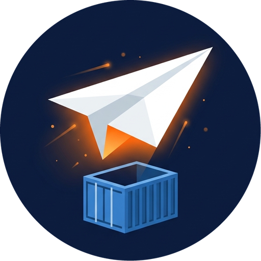

<div align="center">



# DockBench Telegram

**Claude Code in your dev containers, from a Telegram chat.**

One forum topic per DockBench container. Post a task, pick a model, get the answer as a reply, with screenshots in both directions. Several sessions at once, from your phone.

[](https://github.com/Sander972/DockBench-telegram/actions/workflows/build.yml)
[](https://github.com/Sander972/DockBench-telegram/pkgs/container/dockbench-telegram)
[](DEV-README.md#build-it-yourself)
[](LICENSE)
<br>
[](https://github.com/Sander972/DockBench-telegram/commits/main)
[](https://github.com/Sander972/DockBench-telegram/issues)
[](#contributing)

[Getting started](#getting-started) · [Everyday use](#everyday-use) · [Commands](#commands) · [Configuration](#configuration) · [Security](#security) · [Development](DEV-README.md)

</div>

---

## What is it for?

[DockBench](https://github.com/Sander972/DockBench) runs one dev container per project on a server you own, with [Claude Code](https://claude.com/claude-code) installed inside. At a desk you open VS Code. From a phone you just want to tell Claude "fix the failing test and commit" and read the answer when it is done.

This bot is that chat. A private Telegram forum group holds one topic per container, and every message you post in a topic starts a headless Claude Code session in that container. The answer comes back as a reply. These are ordinary Claude Code sessions, so you can also open them in the container's VS Code and carry on there.

### What it does

| | |
|---|---|
| 💬 **A topic per container** | New dev containers get their topic automatically, named after the project. Post text or a screenshot and a session starts in that container. |
| 🎛️ **Pick, then go** | Inline buttons ask the model, the effort and the permission mode for each new session, or repeat your last pick in one tap. |
| 🔁 **Threads are sessions** | Reply to any message of a session to continue it. Send a new message to start another one; sessions run in parallel. |
| 📷 **Images both ways** | Screenshots you send are copied into the container for Claude. Screenshots, charts and diagrams Claude makes come back as photos. |
| 📌 **Pinned status** | Each topic keeps a pinned message with the repo, branch, uncommitted changes, commits to push and the sessions, running or idle. |
| ⬆️ **Push button** | When a branch has commits to push, the pin shows a button. One confirmation tap and the container pushes with its own credentials. |
| 📊 **Claude usage** | A pinned message in General shows the plan limits of every Claude account signed in across your containers. |
| 🧩 **Claude's commands** | Your skills and slash commands show up in Telegram's `/` menu, grouped by plugin. |
| 🧑‍💻 **VS Code aware** | Open any Telegram session in the container's VS Code with its full history, tool calls and diffs. |

## How it works


The bot long-polls Telegram over outbound HTTPS and runs `claude -p` in your dev containers through the Docker socket. It publishes no port, needs nothing beyond the Python standard library, and keeps its state in one JSON file that never holds message text. [DEV-README.md](DEV-README.md#architecture) has the details.

## Getting started

You need:

- a server where your [DockBench](https://github.com/Sander972/DockBench) containers run, with Docker (the published image is `linux/arm64`; [build it](DEV-README.md#build-it-yourself) for x86); the dev containers need a DockBench image from 2026-11-10 or later, or prompts are not run and their pinned status, titles, Stop and idle watchdog do not work;
- a Telegram account, and a bot token from [@BotFather](https://t.me/BotFather).

> [!TIP]
> The [DockBench Dashboard](https://github.com/Sander972/DockBench-Dashboard) does steps 1 to 3 for you: its Telegram page deploys the stack from the token, then shows a *Claim ownership* link and an *Add to group* link that asks Telegram for the right admin permissions. The steps below are the manual path.

### 1. Create the bot

Create a bot with [@BotFather](https://t.me/BotFather) and keep its token. Privacy mode can stay on, since a bot that is a group admin receives every message anyway.

### 2. Deploy it

The bot runs as a non-root user and reaches the Docker socket through the socket's group, so look up that group id on your server:

```sh
stat -c %g /var/run/docker.sock
```

Deploy [`compose.yml`](compose.yml) with `TELEGRAM_BOT_TOKEN` and `DOCKER_GID` set, as a Portainer stack (**Stacks → Add stack**, paste, fill the variables) or with plain Compose:

```sh
docker compose -p dockbench-telegram --env-file telegram.env up -d
```

The log prints a one-time code: `setup: open a private chat with @<bot> and send: /setup <code>`.

### 3. Claim it

Send that `/setup <code>` to the bot in a private chat. You become its owner, the only user it listens to. A wrong code gets no reply, and the code changes on every restart until an owner is set.

### 4. Give it a group

1. Create a private group and enable **Topics** in its settings.
2. Add the bot as admin with **Manage topics**, **Pin messages** and **Delete messages**.
3. Send `/setup@<bot>` in the group. The bot binds itself to the group and replies with a checklist of those rights and of Docker access, with the fix for anything missing. Send it again after a fix.

Within about 30 seconds the bot creates a topic for every running dev container, named after its `PROJECT` (container `dockbench-myapp` → topic `myapp`). Owner and group live in the `state` volume and survive restarts and redeploys. To move the bot to another forum group later, send `/setup@<bot> move` there while nothing is running.

### 5. Try it

Post `what does this project do?` in a topic. Pick a model, an effort and a permission mode on the buttons, watch the status message count the seconds, and read the answer when it replies to you.

## Everyday use

### Sessions

Every message you post in a project topic, as text or as a screenshot with a caption, starts a new Claude Code session. Buttons ask for the model, the effort and the permission mode, and a first row repeats the topic's last pick in one tap. While Claude works, a status message shows the elapsed time, what Claude writes between steps and a **⏹ Stop** button. The answer arrives as a reply to your request.

To continue a session, reply to any of its messages. The follow-up keeps the model, effort and mode of the session and runs after the ones already queued in it. A message that replies to nothing the bot knows starts a new session, in parallel with the others.

### Screenshots and images

A screenshot without a caption means "look at the attached screenshot(s) and fix the bug shown". Send screenshots as files to avoid Telegram's compression. Images Claude makes, such as screenshots, charts and diagrams, come back as photos after the answer.

### Pinned status and pushing

Each topic has a pinned message with the container's repo and branch, uncommitted changes, commits to push and the topic's sessions, updated about every minute. When a branch has commits to push, the pin shows a **⬆** button; after one confirmation tap the container runs `git push` with its own credentials. Pushing is refused while a session of that container is running.

### Claude usage and commands

The General topic has a pinned message with the plan limits of every Claude account signed in in your running containers, refreshed every 10 minutes. Your skills and slash commands appear in Telegram's `/` menu, and any `/command` the bot does not know is sent to Claude as the prompt.

### Sessions in VS Code

Telegram sessions are stored where the Claude Code extension looks, so you can open one from the Claude Code panel's history in the container's VS Code (`/status` shows the link) and keep going there. Open it after the Telegram run has finished, and do not type in it while Telegram is running it.

### Permissions

Headless runs cannot ask for approval, so anything that would need one is denied and a run never hangs.

| Mode | What Claude may do |
|---|---|
| `auto` | Judges by itself what is safe. The usual pick. |
| `acceptEdits` | Edits files; shell commands that need approval are denied. |
| `plan` | Only reads and answers with a plan. Follow-ups keep the mode, so carry the plan out in a new session. |
| `manual` | Anything that needs approval is denied. |
| `bypassPermissions` | Runs everything unchecked. Sessions run as the container's normal user, so the container is the sandbox. |

A `deny` rule for `Bash` in your Claude settings removes the shell tool, and the answer then says so. Narrow the rule (`Bash(rm -rf *)` instead of `Bash`) if Claude needs to build and test.

A run that looks hung is killed after 15 minutes without activity, and a busy one stops at 4 hours or 180 turns. Either way the session is kept, so a reply continues it. [DEV-README.md](DEV-README.md#behavior-in-detail) covers these limits, bot restarts and the other edge cases.

## Commands

| Command | Effect |
|---|---|
| `/status` | Container state, whether Claude is signed in there, the VS Code link, the sessions running in this topic and the last pick. |
| `/stop` | Stop every session running in this topic and drop their queued follow-ups. As a reply to a session's message: only that session. |
| `/push [repo]` | Push the workspace repo, or a repo folder inside it, after a confirmation tap. With several repos to push and no name, asks which. |
| `/clean` | Delete the messages of this topic's idle sessions. Those sessions can no longer be continued from Telegram; they stay in VS Code. The pin's **🧹 Clean idle sessions (N)** button does the same. As a reply to a session's message (`/clean` or `/clear`): only that session, if it is not running. |
| `/purge` | Delete every message of this topic, running sessions included, after a confirmation tap: the bot stops the topic's sessions, deletes the topic and creates a new one with the same name. Its sessions can no longer be continued from Telegram; they stay in VS Code. |
| `/bind <PROJECT>` | Link this topic to `dockbench-<PROJECT>`. |
| `/setup` | Re-run the setup checklist for the group. `/setup move` in another forum group moves the bot there. `/start` does the same: the dashboard's claim and Add to group links send it. |
| `/help` | The command list. Also what the bot answers in the General topic. |

Anything else, including slash commands the bot does not know, is the prompt.

## Configuration

All settings are environment variables of the stack. [`.env.example`](.env.example) lists them.

| Variable | Required | What it does |
|---|---|---|
| `TELEGRAM_BOT_TOKEN` | yes | From BotFather. Lives only in the stack environment. |
| `DOCKER_GID` | yes | Group id of `/var/run/docker.sock` on the host (`stat -c %g /var/run/docker.sock`). |
| `TELEGRAM_GROUP_ID` | no | The forum supergroup, `-100…`. Normally set by `/setup` in the group; setting it here pins the group and ignores the stored one. |
| `TELEGRAM_OWNER_ID` | no | The only Telegram user the bot listens to. Normally set by `/setup <code>`; setting it here skips the code. |
| `DOCKER_HOST` | no | Default `unix:///var/run/docker.sock`. A `tcp://` URL goes through a socket proxy (see [DEV-README.md](DEV-README.md#security)). |
| `CPUSET` | no | Cores the bot may run on, as a Linux cpuset list (`1-3`). Empty (default) means every core. The DockBench Dashboard sets every core but 0, so core 0 stays free for the host. |

To update, pull the new image and recreate the container: the dashboard's **Pull and restart** button, or redeploy the stack in Portainer with "pull latest image".

## Security

The bot is a shell in every dev container. It accepts exactly one Telegram user in exactly one group and drops everything else without answering. Claiming it needs the one-time code from the server's logs. It never logs message text or the token, never passes a prompt through a shell, runs as a non-root user with no published port (its only listener, the dashboard's `/status` on port 8080, has no auth and is reachable from every dev container on `devnet`, so it never returns ids, the setup code or the token), and only touches containers labeled `dockbench=true`.

> [!WARNING]
> The Docker socket gives root-equivalent access to the host, read-only mount or not. [DEV-README.md](DEV-README.md#security) explains why a socket proxy buys little and how to add one anyway.

## Contributing

The bot needs Python 3.13 and has no dependencies. `python bot.py --check` runs the self-check that CI runs before building the image. [DEV-README.md](DEV-README.md) covers the architecture, the rules the code keeps, the implementation notes and how to build the image yourself.

## License

[MIT](LICENSE)
